# Buddy Work for Windows

Buddy keeps notes, clipboard history, downloads, timers, and device controls in an island at the top of your desktop. Click the island or press **Ctrl+Alt+Space** to expand it.

**[Download for Windows x64][setup]** · [Portable ZIP][portable] · [Release notes and checksums][release]

**0.1.1-beta.46** · 24.06 MB installer · 45.35 MB installed on Windows 11 x64

## Workspaces

**Quick Access** keeps apps, websites, files, and folders on one shelf. **Clipboard** keeps a searchable history of text, links, and images. Open any screenshot at full size.

  <a href="https://raw.githubusercontent.com/AaronCampbellit/buddy-work-windows/main/docs/screenshots/quick-shelf.png">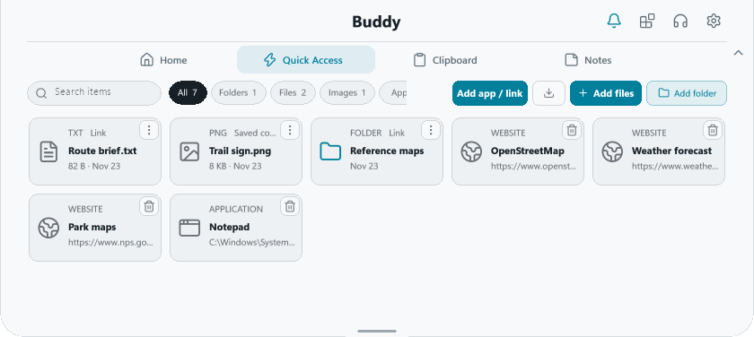</a>
  <a href="https://raw.githubusercontent.com/AaronCampbellit/buddy-work-windows/main/docs/screenshots/clipboard-overflow.png">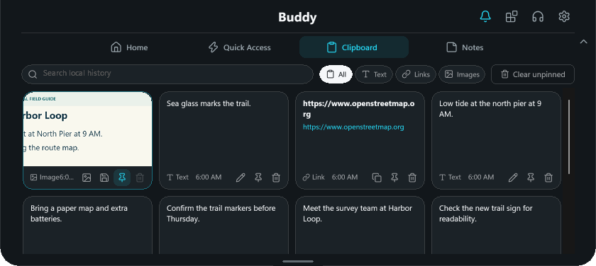</a>

**Home** shows a selected note alongside playback controls for the current track. **Notes** opens the full editor with formatted text, inline images, links, and a reminder field.

  <a href="https://raw.githubusercontent.com/AaronCampbellit/buddy-work-windows/main/docs/screenshots/home-playing.png">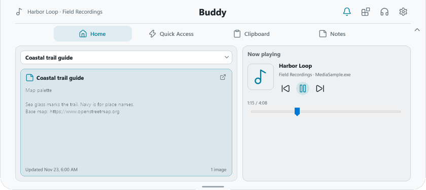</a>
  <a href="https://raw.githubusercontent.com/AaronCampbellit/buddy-work-windows/main/docs/screenshots/rich-note.png">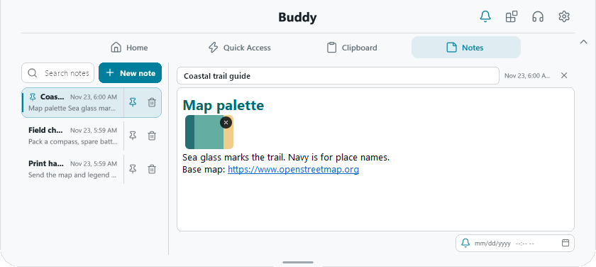</a>

## Features

| Workspace | What you can do |
| --- | --- |
| **[Notes and reminders](#notes-and-side-widgets)** | Search notes by title or body, paste formatted text and inline images, open web links, and schedule or snooze reminders. Edit a note directly in its side widget. |
| **[Clipboard and images](#image-markup-ocr-and-rewrite)** | Find and pin copied text, links, and images. Crop or annotate an image, export a PNG, or extract Latin-script text with local OCR. |
| **[Focus and timers](#notes-and-side-widgets)** | Run Pomodoro focus sessions with short and long breaks. Record stopwatch laps and keep either timer beside the island. |
| **[Quick Access and files](#file-shelf-and-downloads)** | Pin websites and apps, drag files or folders onto the shelf, and choose whether to link the original or keep a separate copy. Find recent downloads and reveal them in Explorer. |
| **[Media and notifications](#media-and-notifications)** | Control playback in compatible apps. With Windows notification access enabled, choose whether previews show an icon, a title, or the full message. |
| **[Audio and camera](#audio-and-camera)** | Mute or change volume, choose default audio devices, and adjust supported camera controls. The virtual camera studio adds backgrounds, picture-in-picture, and a standby screen. |
| **[Island settings](#settings-and-diagnostics)** | Choose a monitor, screen position, theme, and scale. Open on click or hover, reduce motion, or hide the island during fullscreen apps. |
| **[Rewrite](#image-markup-ocr-and-rewrite) and [diagnostics](#settings-and-diagnostics)** | Send selected text to a separately installed Codex CLI for an optional rewrite. Capture a local performance report or check a configured update feed. |

## File shelf and Downloads

Filter the shelf to **Files** to see linked originals and saved copies. **Downloads** shows recent files with their sizes and actions to open them or reveal them in Explorer.

  <a href="https://raw.githubusercontent.com/AaronCampbellit/buddy-work-windows/main/docs/screenshots/file-shelf.png">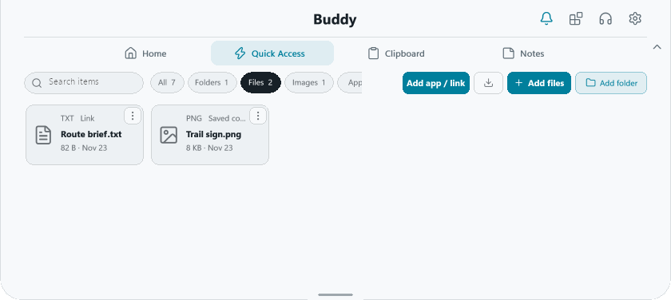</a>
  <a href="https://raw.githubusercontent.com/AaronCampbellit/buddy-work-windows/main/docs/screenshots/downloads.png">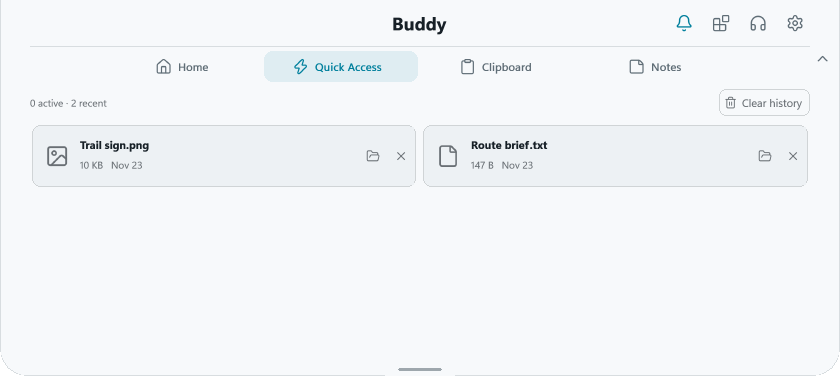</a>

## Image markup, OCR and Rewrite

Open a clipboard image in **Image markup**. Use the editor to crop, annotate, or export it. Here a blue rectangle marks the meeting details on a trail sign.

  <a href="https://raw.githubusercontent.com/AaronCampbellit/buddy-work-windows/main/docs/screenshots/markup-library.png">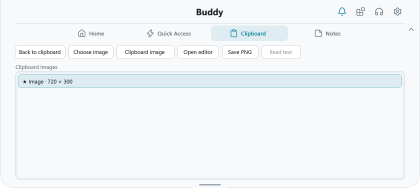</a>
  <a href="https://raw.githubusercontent.com/AaronCampbellit/buddy-work-windows/main/docs/screenshots/markup-annotated.png">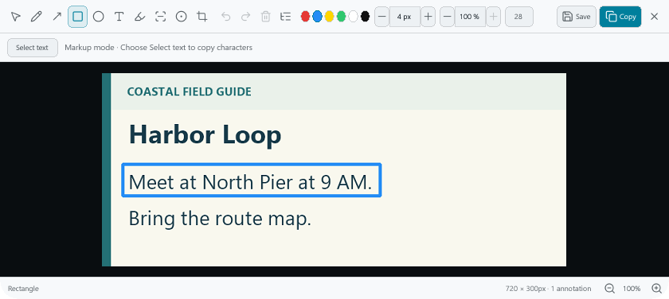</a>

**Read image text** recognizes words locally and lets you copy the result. **AI Rewrite** lets you choose a tone and review the source before sending it through your separately installed Codex CLI.

  <a href="https://raw.githubusercontent.com/AaronCampbellit/buddy-work-windows/main/docs/screenshots/ocr.png">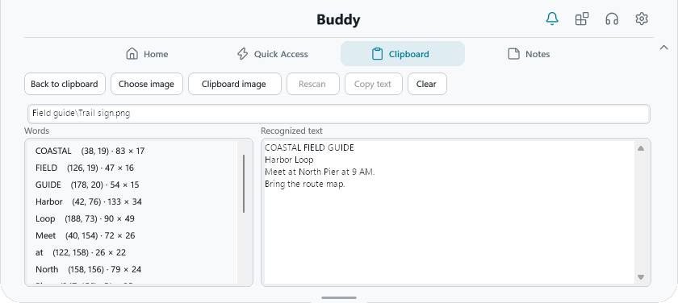</a>
  <a href="https://raw.githubusercontent.com/AaronCampbellit/buddy-work-windows/main/docs/screenshots/rewrite.png">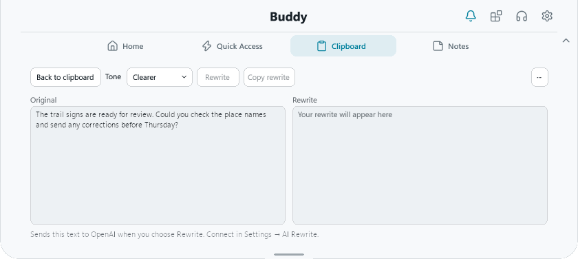</a>

## Notes and side widgets

**Widgets** holds the Pomodoro timer, stopwatch, laps, and side-widget pickers. A pinned note stays editable beside the compact island. A pinned clipboard image keeps its preview and actions within reach.

  

### Pin a note

1. Open **Notes** and choose **New note**. Type a title and body. Buddy saves your edits automatically.
2. Open **Widgets** in the island header. Under **Side widgets**, choose your note, then collapse the island.
3. Edit the title or body directly in the widget. Press **Ctrl+V** or right-click and choose **Paste** to insert an image at the cursor. The widget saves as you edit. Choose **Open note in Buddy** to continue in the main editor.

  <a href="https://raw.githubusercontent.com/AaronCampbellit/buddy-work-windows/main/docs/screenshots/rich-pinned-note.png">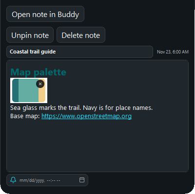</a>
  <a href="https://raw.githubusercontent.com/AaronCampbellit/buddy-work-windows/main/docs/screenshots/pinned-clipboard.png">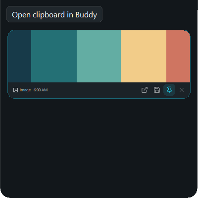</a>

## Media and notifications

**Media** shows the current Windows media session with playback and seek controls. The **notification center** collects recent notifications when Windows access is enabled. The capture shows the empty inbox.

  <a href="https://raw.githubusercontent.com/AaronCampbellit/buddy-work-windows/main/docs/screenshots/media-playing.png">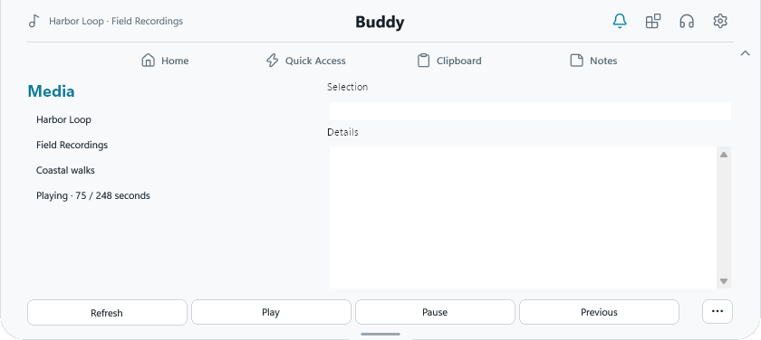</a>
  <a href="https://raw.githubusercontent.com/AaronCampbellit/buddy-work-windows/main/docs/screenshots/recent-notifications.png">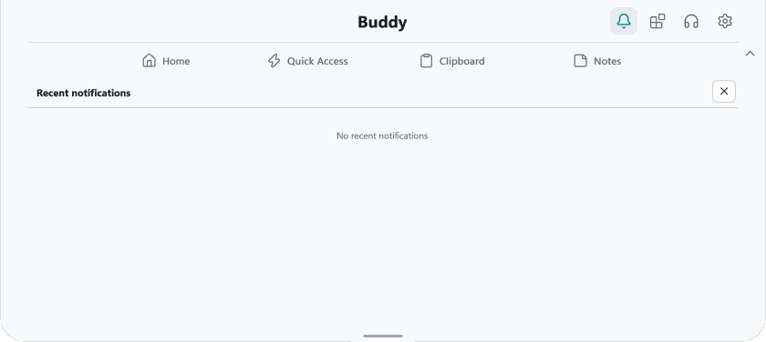</a>

## Audio and camera

Switch between **Input** and **Output** to manage microphones and playback devices. The Windows test VM had no connected audio endpoints.

  <a href="https://raw.githubusercontent.com/AaronCampbellit/buddy-work-windows/main/docs/screenshots/devices.png">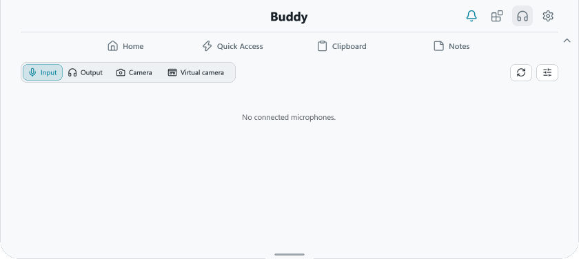</a>
  <a href="https://raw.githubusercontent.com/AaronCampbellit/buddy-work-windows/main/docs/screenshots/audio-output.png">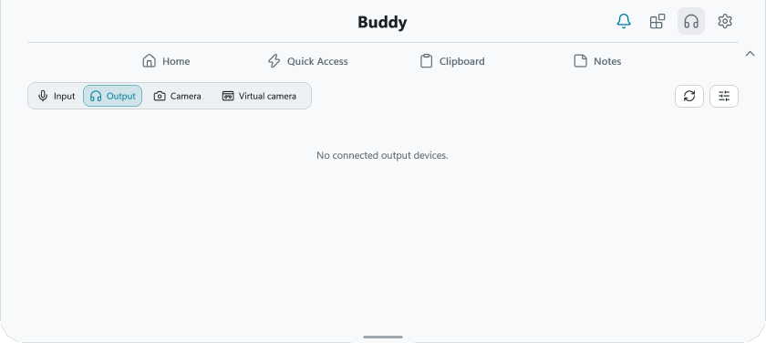</a>

The physical **Camera** page separates framing from picture adjustments. These screenshots show both control panels with the preview off.

  <a href="https://raw.githubusercontent.com/AaronCampbellit/buddy-work-windows/main/docs/screenshots/camera.png">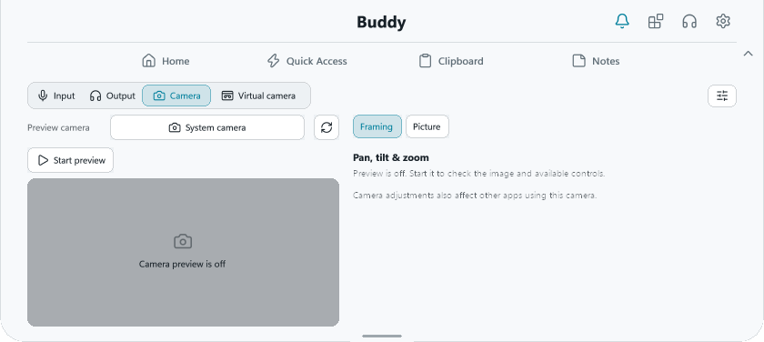</a>
  <a href="https://raw.githubusercontent.com/AaronCampbellit/buddy-work-windows/main/docs/screenshots/camera-picture.png">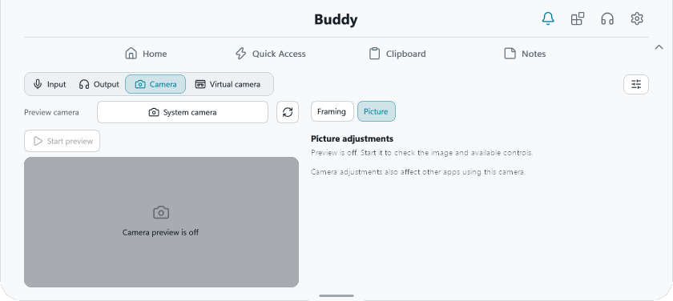</a>

### Virtual camera studio

Choose a **Background**, add a **Name & logo**, or configure **Picture-in-picture**. The **Standby**, **Saved scenes**, and **Camera & output** tabs handle what viewers see between calls and which source supplies the video.

  <a href="https://raw.githubusercontent.com/AaronCampbellit/buddy-work-windows/main/docs/screenshots/studio.png">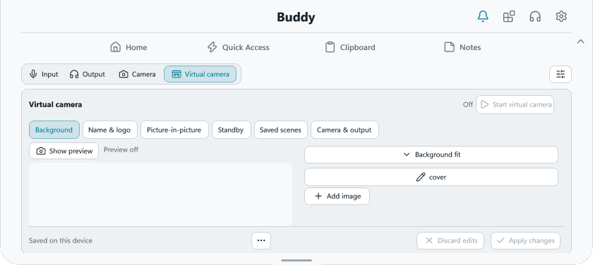</a>
  <a href="https://raw.githubusercontent.com/AaronCampbellit/buddy-work-windows/main/docs/screenshots/studio-name.png">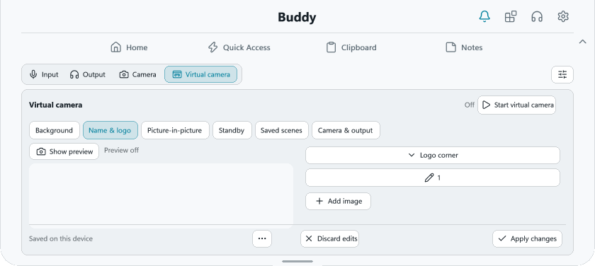</a>
  <a href="https://raw.githubusercontent.com/AaronCampbellit/buddy-work-windows/main/docs/screenshots/studio-pip.png">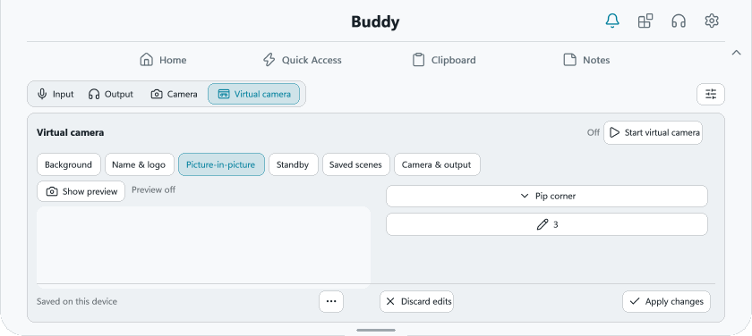</a>
  <a href="https://raw.githubusercontent.com/AaronCampbellit/buddy-work-windows/main/docs/screenshots/studio-standby.png">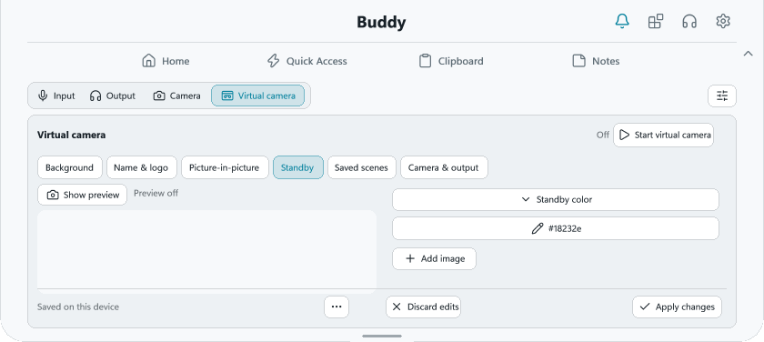</a>
  <a href="https://raw.githubusercontent.com/AaronCampbellit/buddy-work-windows/main/docs/screenshots/studio-scenes.png">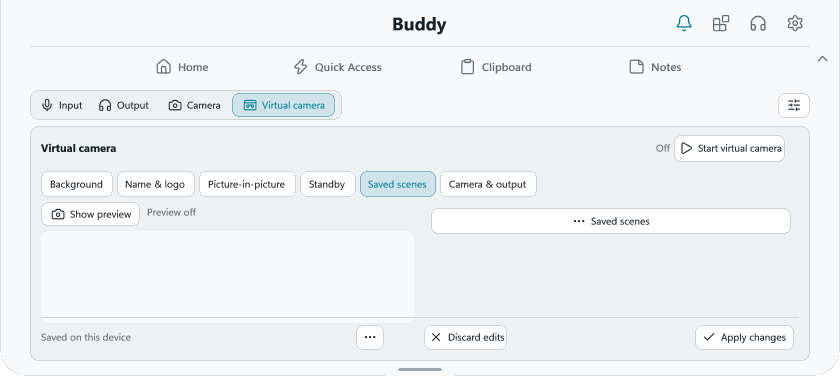</a>
  <a href="https://raw.githubusercontent.com/AaronCampbellit/buddy-work-windows/main/docs/screenshots/studio-output.png">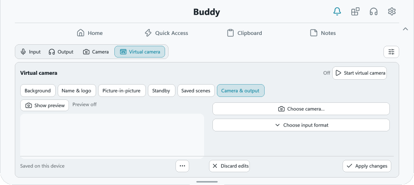</a>

## Settings and diagnostics

**General** includes launch at login, performance capture, and update checks. **Appearance** lets you set custom colors, order the tabs, and adjust scale and motion.

  <a href="https://raw.githubusercontent.com/AaronCampbellit/buddy-work-windows/main/docs/screenshots/settings.png">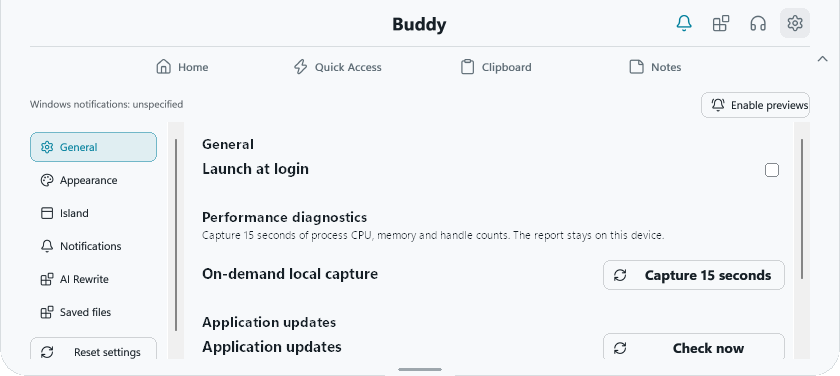</a>
  <a href="https://raw.githubusercontent.com/AaronCampbellit/buddy-work-windows/main/docs/screenshots/appearance.png">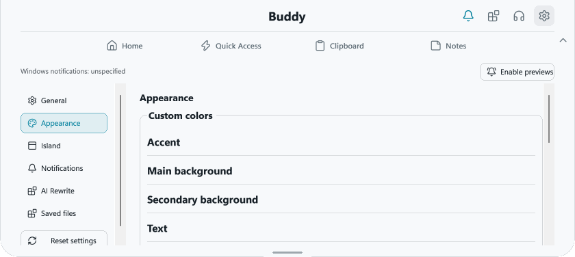</a>

**Island** sets the monitor, opening mode, and placement. **Notifications** controls preview privacy, grouping, and duration.

  <a href="https://raw.githubusercontent.com/AaronCampbellit/buddy-work-windows/main/docs/screenshots/settings-island.png">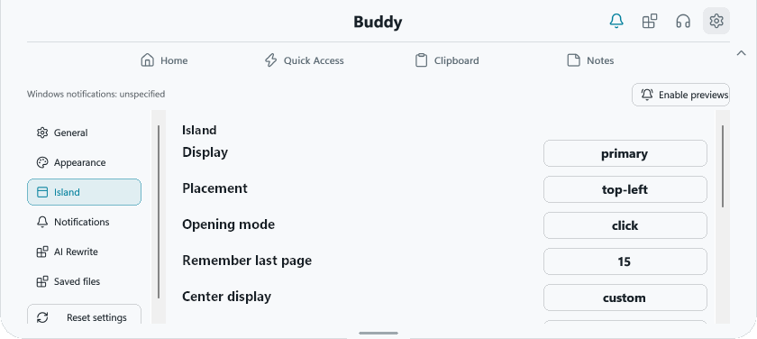</a>
  <a href="https://raw.githubusercontent.com/AaronCampbellit/buddy-work-windows/main/docs/screenshots/settings-notifications.png">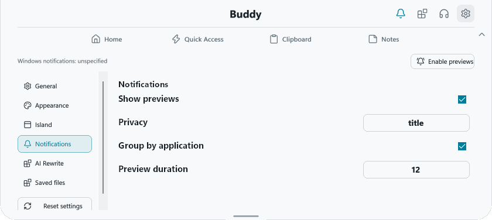</a>

**AI Rewrite** manages CLI sign-in and rewrite preferences. **Saved files** opens the shelf or changes where Buddy stores its copies.

  <a href="https://raw.githubusercontent.com/AaronCampbellit/buddy-work-windows/main/docs/screenshots/settings-rewrite.png">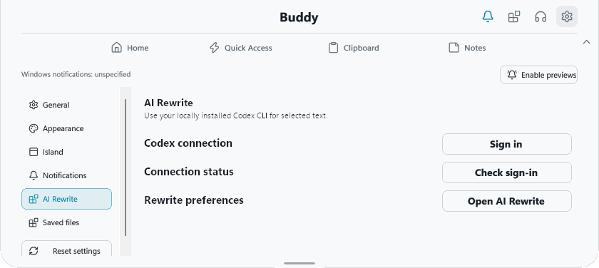</a>
  <a href="https://raw.githubusercontent.com/AaronCampbellit/buddy-work-windows/main/docs/screenshots/settings-files.png">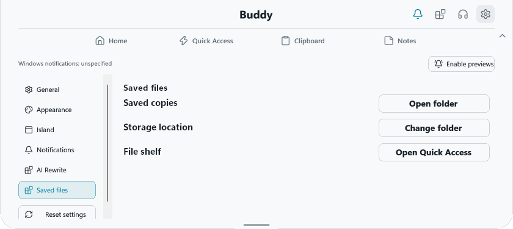</a>

**Updates and diagnostics** can record 15 seconds of local CPU, memory, and handle counts, open the report folder, or check a configured update feed.

  <a href="https://raw.githubusercontent.com/AaronCampbellit/buddy-work-windows/main/docs/screenshots/diagnostics.png">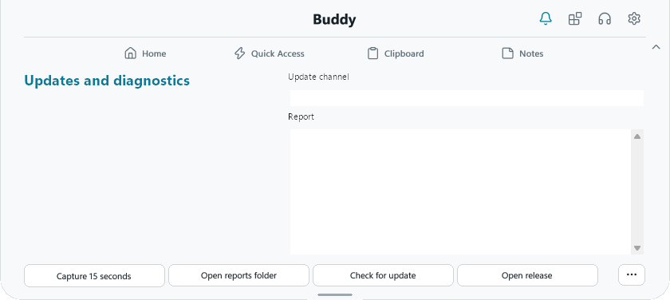</a>

## Island motion

<strong>Watch the island open and close</strong>

The island expands around the status header while the workspace fades into view. Windows reduced-motion settings and Buddy’s own reduced-motion switch make the change immediate.

<picture>
  <source media="(prefers-reduced-motion: reduce)" srcset="docs/screenshots/notes.png">
  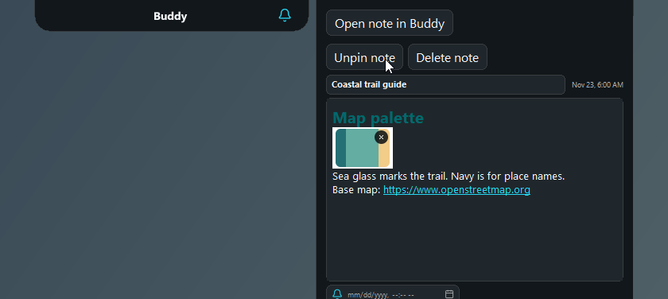
</picture>

[Compare the web and native interfaces side by side](docs/ui-comparison.md) for twelve matched views on Windows 11 and the startup and memory measurements.

## Install and permissions

The installer runs under your Windows user account and is unsigned. The app folder uses 45,354,407 bytes, including 24.54 MB of camera files and 12.23 MB for local OCR. Registering the optional shared Buddy Camera component brings the combined footprint to 72.49 MB on the test machine, before user data. The release also includes an unsigned MSIX for organizations that sign and deploy their own packages. [All downloads and SHA-256 checksums][release]

Windows encrypts saved notes and clipboard history for the current user. OCR runs on your device. Reading other apps’ notifications requires Windows consent, and registering the optional virtual camera can require administrator approval. [Feature permissions](native-rust/README.md#features-and-access)

## Build from source

Buddy uses Rust and native Win32 controls. Build from `native-rust` on Windows x64. To package the app, extract the matching portable ZIP and pass its `Buddy\camera` folder to the packager. [Build and packaging instructions](native-rust/README.md#build-and-package-on-windows-x64)

[setup]: https://github.com/AaronCampbellit/buddy-work-windows/releases/download/v0.1.1-beta.46/Buddy-Work-Rust-Setup-x64.exe
[portable]: https://github.com/AaronCampbellit/buddy-work-windows/releases/download/v0.1.1-beta.46/Buddy-Work-Rust-Portable-x64.zip
[release]: https://github.com/AaronCampbellit/buddy-work-windows/releases/tag/v0.1.1-beta.46
