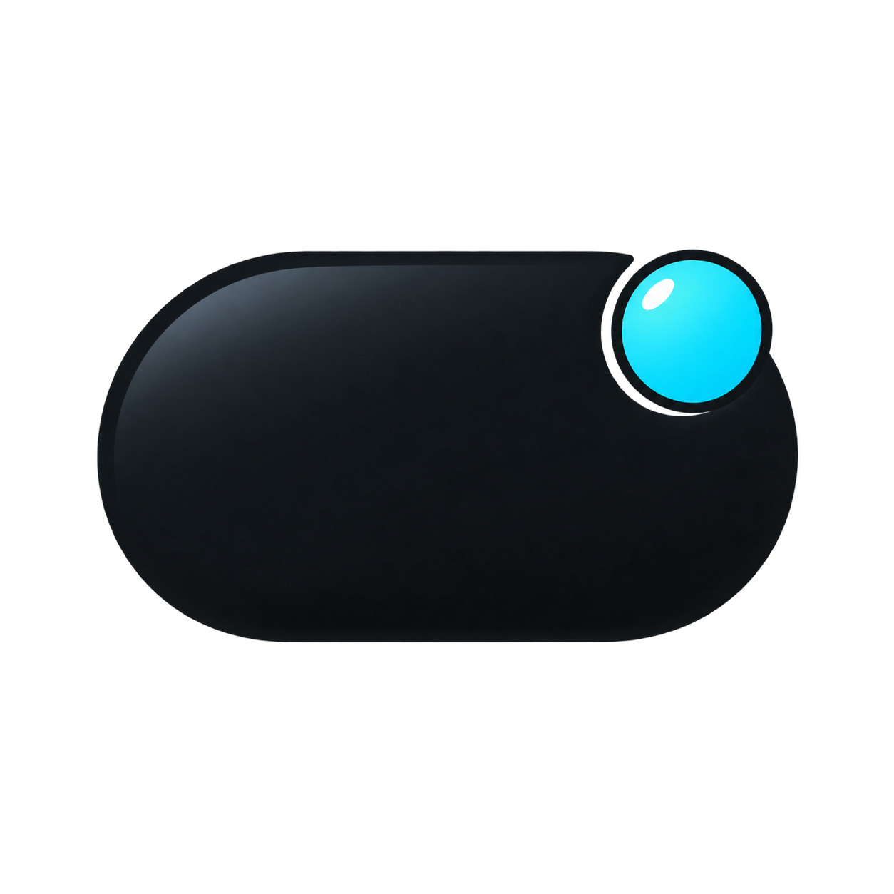
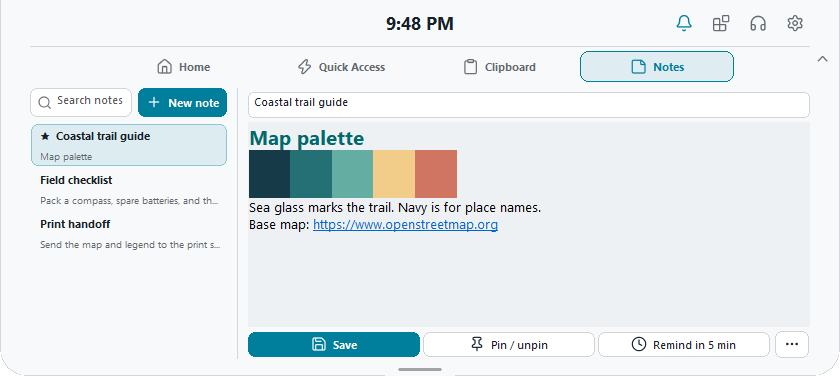
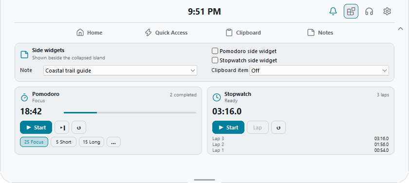

# Buddy Work for Windows

Buddy puts an editable note, your clipboard, and a focus timer at the top of your desktop. Click the island or press **Ctrl+Alt+Space** to expand it. A note can stay open beside the compact island while you work in another app.

**[Download for Windows x64][setup]** · [Portable ZIP][portable] · [Release notes and checksums][release]

**0.1.1-beta.44** · 23.91 MB installer · 44.94 MB installed on Windows 11 x64

## Features

| Workspace | What you can do |
| --- | --- |
| **Notes and reminders** | Search notes by title or body, paste formatted text and inline images, open web links, and schedule or snooze reminders. Edit a note directly in its side widget. |
| **Clipboard and images** | Find and pin copied text, links, and images. Crop or annotate an image, export a PNG, or extract Latin-script text with local OCR. |
| **Focus and timers** | Run Pomodoro focus sessions with short and long breaks. Record stopwatch laps and keep either timer beside the island. |
| **Quick Access and files** | Pin websites and apps, drag files or folders onto the shelf, and choose whether to link the original or keep a separate copy. Find recent downloads and reveal them in Explorer. |
| **Media and notifications** | Control playback in compatible apps. With Windows notification access enabled, choose whether previews show an icon, a title, or the full message. |
| **Audio and camera** | Mute or change volume, choose default audio devices, and adjust supported camera controls. The virtual camera studio adds backgrounds, picture-in-picture, and a standby screen. |
| **Island settings** | Choose a monitor, screen position, theme, and scale. Open on click or hover, reduce motion, or hide the island during fullscreen apps. |
| **Rewrite and diagnostics** | Send selected text to a separately installed Codex CLI for an optional rewrite. Capture a local performance report or check a configured update feed. |

## Try a pinned note

1. Open **Notes**, create a note, and choose **Save**.
2. Open **Widgets** in the island header. Under **Side widgets**, choose your note, then collapse the island.
3. Edit the title or body directly in the widget. Press **Ctrl+V** or right-click and choose **Paste** to insert an image at the cursor. The widget saves as you edit. Choose **Open note in Buddy** to continue in the main editor.

## More screenshots

**Clipboard in dark mode** shows the selected image beside recent text and links.

<strong>Show the Pomodoro timer and stopwatch</strong>

## Install and permissions

The installer runs under your Windows user account and is unsigned. The release also includes an unsigned MSIX for organizations that sign and deploy their own packages. [All downloads and SHA-256 checksums][release]

Windows encrypts saved notes and clipboard history for the current user. OCR runs on your device. Reading other apps’ notifications requires Windows consent, and registering the optional virtual camera can require administrator approval. [Feature permissions](native-rust/README.md#features-and-access)

## Build from source

Buddy uses Rust and native Win32 controls. Build from `native-rust` on Windows x64. To package the app, extract the matching portable ZIP and pass its `Buddy\camera` folder to the packager. [Build and packaging instructions](native-rust/README.md#build-and-package-on-windows-x64)

[setup]: https://github.com/AaronCampbellit/buddy-work-windows/releases/download/v0.1.1-beta.44/Buddy-Work-Rust-Setup-x64.exe
[portable]: https://github.com/AaronCampbellit/buddy-work-windows/releases/download/v0.1.1-beta.44/Buddy-Work-Rust-Portable-x64.zip
[release]: https://github.com/AaronCampbellit/buddy-work-windows/releases/tag/v0.1.1-beta.44
