# Windows UI comparison

The left column shows the original work-edition web interface rendered by Microsoft Edge on Windows 11. The right column shows the native Rust release on the same VM. Open either image at full size to inspect the text, spacing and controls.

The captures use the same synthetic notes, links, image, timer values and pinned websites. The expanded island is 840 × 376 at 100% scale. The pinned note sits beside the collapsed island in its own 400-pixel-wide window. Both editions use the custom center label “Buddy.”

| Web reference | Native Rust |
| --- | --- |
| **Notes** | **Notes** |
| [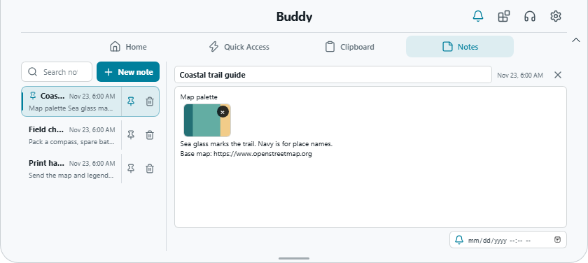](comparison/web-notes.png) | [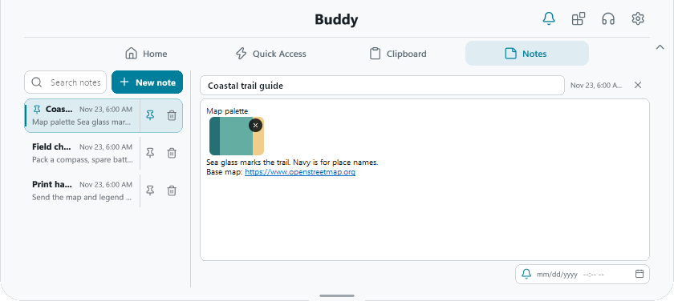](screenshots/notes.png) |
| **Pinned note** | **Pinned note** |
| [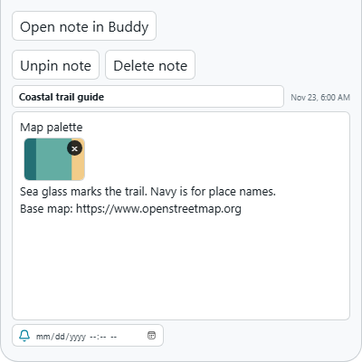](comparison/web-pinned-note.png) | [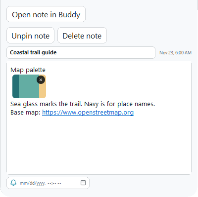](screenshots/pinned-note.png) |
| **Clipboard** | **Clipboard** |
| [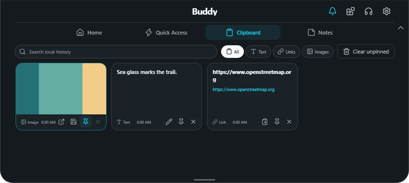](comparison/web-clipboard.png) | [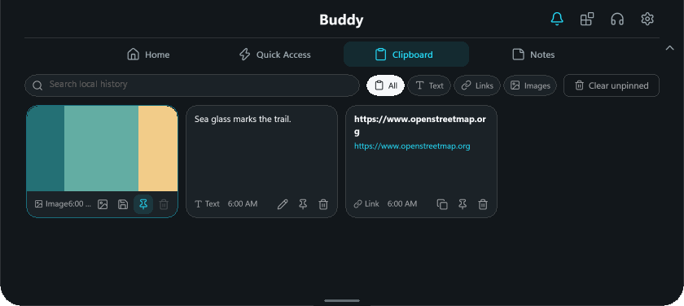](screenshots/clipboard.png) |
| **Quick Access** | **Quick Access** |
| [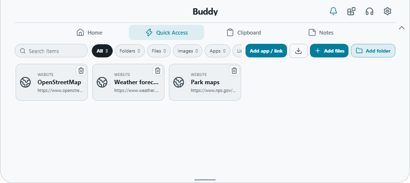](comparison/web-quick.png) | [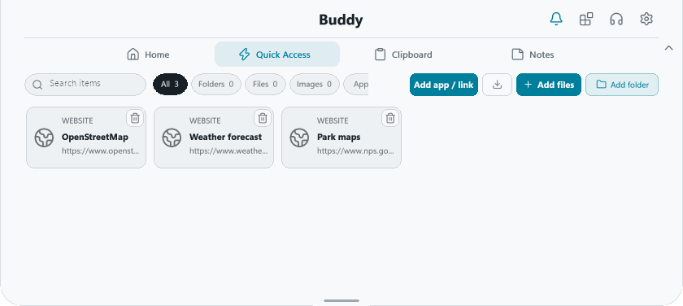](screenshots/quick.png) |
| **Timers and widgets** | **Timers and widgets** |
| [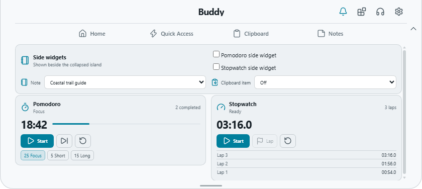](comparison/web-timers.png) | [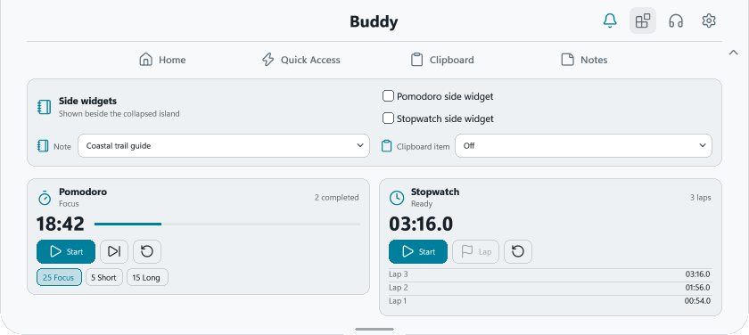](screenshots/timers.png) |
| **Home** | **Home** |
| [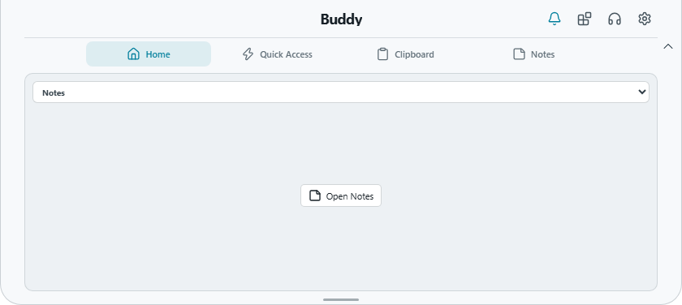](comparison/web-home.png) | [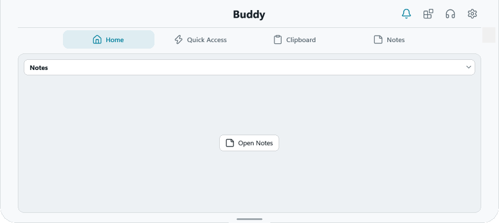](screenshots/home.png) |
| **Pinned clipboard** | **Pinned clipboard** |
| [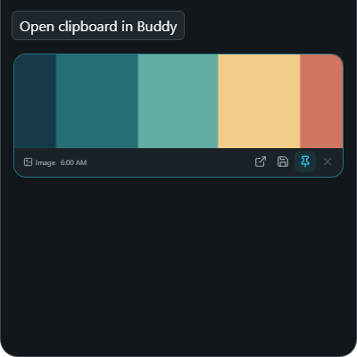](comparison/web-pinned-clipboard.png) | [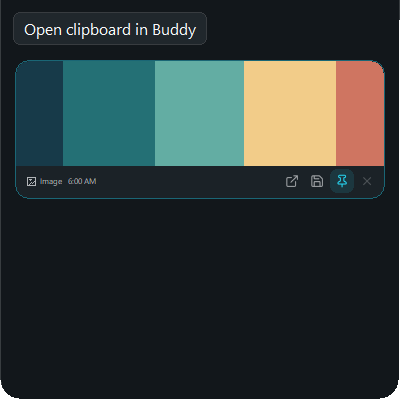](screenshots/pinned-clipboard.png) |
| **Audio input** | **Audio input** |
| [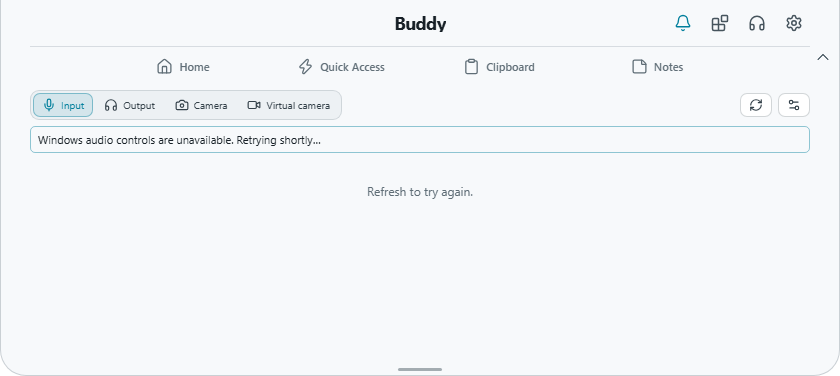](comparison/web-devices.png) | [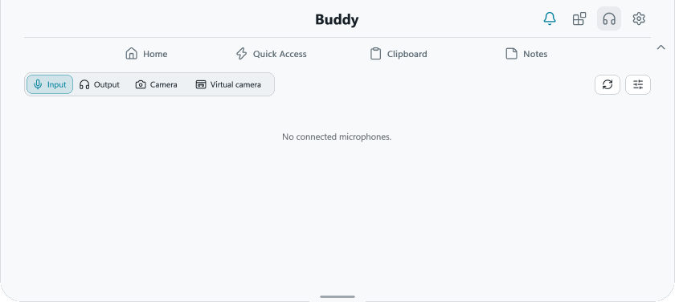](screenshots/devices.png) |
| **Physical camera** | **Physical camera** |
| [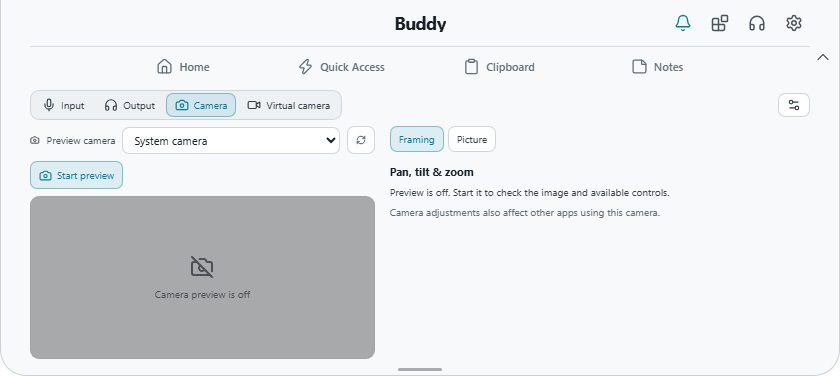](comparison/web-devices-camera.png) | [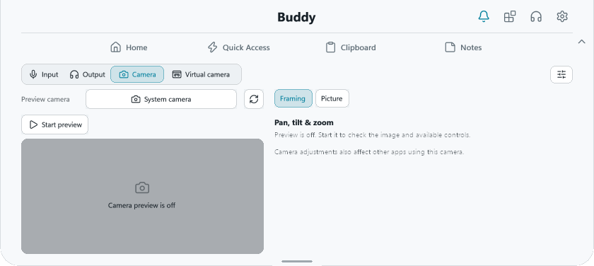](screenshots/camera.png) |
| **Virtual camera** | **Virtual camera** |
| [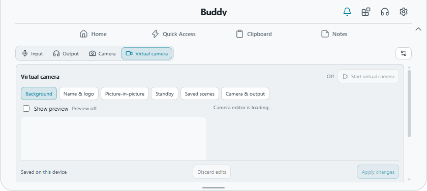](comparison/web-devices-virtual-camera.png) | [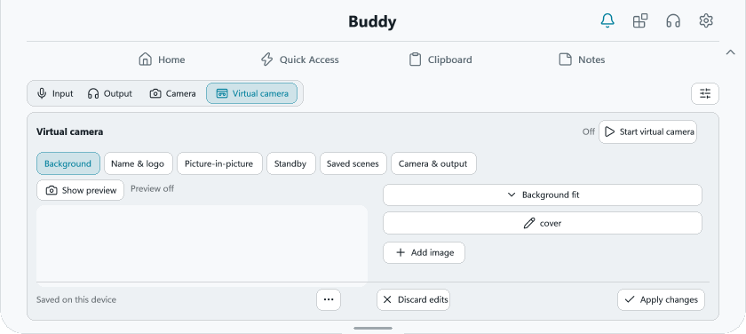](screenshots/studio.png) |
| **General settings** | **General settings** |
| [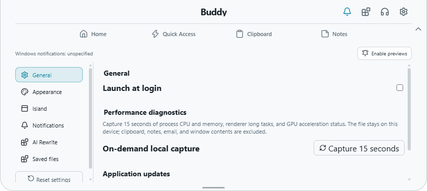](comparison/web-settings.png) | [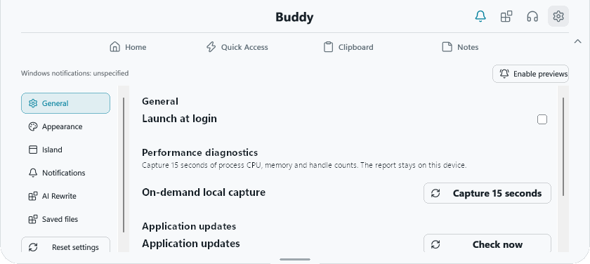](screenshots/settings.png) |
| **Appearance** | **Appearance** |
| [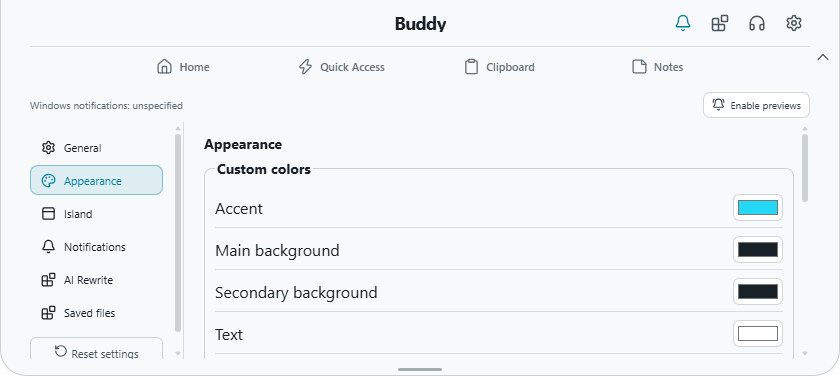](comparison/web-settings-appearance.png) | [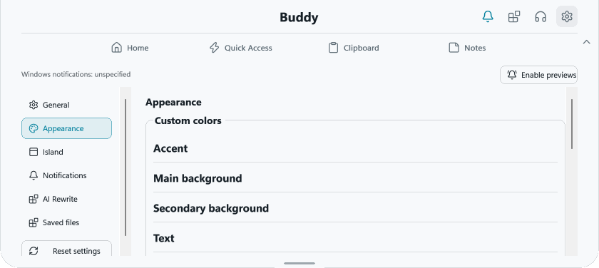](screenshots/appearance.png) |

The previous Rust release put clipboard history in a list and showed one selected preview. The new layout exposes the thumbnail, type, time and actions on each card. [Clipboard in beta.44](comparison/clipboard-beta44.png)

## Visible differences

Windows RichEdit supplies the native text caret, link styling, selection and formatted paste. The Windows scrollbars, date picker, font rasterization and corner edges can also differ between the two renderers. The Clipboard image occupies the same 185 × 105 pixels in both captures. In the main Notes editor the inline thumbnail starts two pixels farther left and three pixels higher in Rust. The audio and camera screens show the device state each app reported on the test VM. Live camera video and active-call controls were outside this comparison.

## Startup, memory and motion

We launched each edition on a signed-in Windows 11 VM, opened Notes, created a draft, and read the edited title back. Each edition used its own profile. Global listeners were disabled and Downloads used test data. The table shows the median of seven alternating launches with an existing profile. Memory is private committed memory across the process tree, measured 800 ms after the edit. [Raw measurements](comparison/notes-performance.csv)

| Notes benchmark | Native Rust beta.45 | WebView2 beta.41 |
| --- | ---: | ---: |
| Launch to verified edit | 1.14 s | 2.97 s |
| Private committed memory | 3.20 MiB | 141.43 MiB |
| Processes | 1 | 8 |

The first launch with a fresh profile took 1.59 s in Rust and 3.31 s in WebView2.

Across six paired launches, the native island began changing width 47 ms after the open command, down from 65 ms in beta.44. The first width change fell from 384 to 197 pixels. The median interval between visible opening steps was 16 ms and the 95th percentile was 28 ms. The island returned to its intended position through 72 interrupted transitions. Keyboard focus, hover re-entry and reduced motion also passed on Windows.
